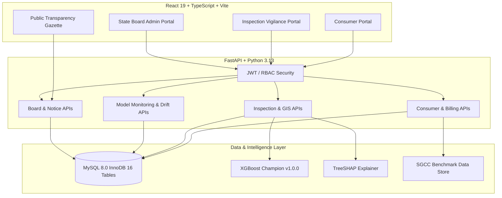

# POWERCONNECT — ACADEMIC DEMONSTRATION & OPERATIONAL WALKTHROUGH GUIDE

**Platform**: PowerConnect — Electricity Theft Intelligence & Inspection Platform  
**Target Audience**: Academic Reviewers, Project Evaluators, Software Engineering Assessors  
**Phase**: Phase 8 Final Operational Demonstration  
**Revision Date**: October 15, 2026  

---

## 1. Demonstration Overview & System Architecture

PowerConnect is an enterprise-grade electricity utility platform that demonstrates how machine learning intelligence, operational field management, and consumer services integrate into a unified, secure, and auditable software architecture.



---

## 2. Environment Preparation & Service Startup

### 2.1 Prerequisites Checklist
1. **Node.js**: v18.0 or higher (`node -v`)
2. **Python**: v3.10 or higher (`python --version`)
3. **MySQL**: 8.0 running locally on port 3306 with database `electricity_theft_db` initialized.

### 2.2 Standard Startup Sequence (Single Command)
Open a PowerShell terminal in the repository root and run:
```powershell
.\run_powerconnect.ps1
```
*Alternatively, on standard Windows command prompt:*
```cmd
run_powerconnect.bat
```

### 2.3 Manual Multi-Terminal Startup (Fallback)
If preferred for fine-grained process inspection:

**Terminal 1 — Backend API Server**:
```powershell
uvicorn backend.app.main:app --host 127.0.0.1 --port 8000 --reload
```

**Terminal 2 — Frontend Application**:
```powershell
npm run dev
```

### 2.4 Pre-Demonstration Health Verification
Open your browser or run a cURL command against the health probe:
```powershell
curl http://127.0.0.1:8000/health
```
**Expected Response**:
```json
{
  "status": "healthy",
  "active_model_version": "v1.0.0",
  "components": {
    "database": "connected",
    "inference_model": "ready"
  }
}
```

---

## 3. Seed Accounts & Credentials

The platform is pre-populated with deterministic demonstration accounts representing distinct organizational roles:

| Role | Username | Password | Purpose & Capabilities |
|---|---|---|---|
| **Consumer** | `cons_01` | `Utility@2026` | Interval consumption analytics, demonstrative billing, grievance ticketing. |
| **Vigilance Employee** | `emp001` | `Utility@2026` | Flying squad dispatch, inspection queue, SHAP drivers, field outcome logging. |
| **Board Administrator** | `board_admin` | `Utility@2026` | Official gazette publication, policy bulletins, grid grievance oversight. |

---

## 4. Step-by-Step Demonstration Script (5 Acts)

### Act 1: Consumer Portal — Self-Service & Interval Analytics
*Goal: Demonstrate consumer transparency, anti-theft privacy isolation, and grievance logging.*

1. **Access**: Navigate to `http://localhost:5173/login`.
2. **Login**: Enter username `cons_01` and password `Utility@2026`.
3. **Landing**: The user is redirected to `/consumer`.
4. **Key Features to Highlight**:
   - **Account Summary**: View meter number, tariff category (Domestic), and sanctioned load (4.5 kW).
   - **Interval Consumption Chart**: View 30-day interactive daily consumption history (kWh) powered by Recharts. Point out that the consumer sees zero internal theft flags, probabilities, or vigilance markers (anti-theft isolation).
   - **Demonstrative Billing**: Navigate to the Billing tab. Show the current bill. Click **"Pay Bill (Demo)"** to demonstrate an atomic state change from `PENDING` to `PAID` with transaction timestamping. (Clarify that this is a simulated workflow, not Stripe).
   - **Grievance Submission**: Navigate to the Complaints tab. Submit a test complaint (`METER_FAULT`, "Abnormal meter reading sound"). Show that a ticket number (`TKT-...`) is generated immediately and stored in MySQL.
   - **Guided Tour & Theme Toggle**: Launch the Consumer Guided Tour or toggle Dark/Light mode using the header controls.
5. **Logout**: Click the user profile icon and select **"Sign Out"**.

---

### Act 2: Employee Portal — Vigilance Intelligence & Prioritization
*Goal: Demonstrate how machine learning risk prioritizes field inspections with SHAP explainability.*

1. **Access**: Navigate to `http://localhost:5173/login`.
2. **Login**: Enter username `emp001` and password `Utility@2026`.
3. **Landing**: The user is redirected to `/employee`.
4. **Key Features to Highlight**:
   - **Inspection Queue**: Point out that cases are sorted not just by raw theft probability, but by **Operational Priority Score** ($\text{Risk} \times \text{Tariff Weight} \times \text{Volume}$), maximizing utility recovery ROI.
   - **Case Investigation**: Click on the top-priority case.
   - **TreeSHAP Explainability Waterfall**: Explain the top feature drivers (e.g. `night_ratio` dropping abruptly, `daily_consumption_mean` down 65% relative to feeder baseline). Highlight to evaluators that this provides transparent decision-support rather than a black-box accusation.
   - **60-Day Telemetry History**: Review the daily interval curve showing the drop pattern.
   - **GIS Map Visualization**: Switch to the GIS tab. Show geocoded meter pins across North, South, and Industrial distribution zones with color-coded severity markers.
   - **Field Outcome Recording**:
     - Click **"Record Inspection Outcome"**.
     - Select finding: `THEFT_CONFIRMED`.
     - Select tamper method: `METER_BYPASS`.
     - Enter recovery penalty: `₹14,500`.
     - Click **"Submit Verified Result"**.
     - Show that the case status immediately transitions to `COMPLETED` and an immutable audit record is committed to MySQL.

---

### Act 3: Closed-Loop Governance & Model Monitoring
*Goal: Demonstrate that model monitoring and retraining follow strict engineering safeguards.*

1. **Navigation**: While logged in as `emp001`, click **"Model Governance"** in the sidebar.
2. **Key Features to Highlight**:
   - **Tab 1: Three-Tier Model Intelligence**:
     - **Tier 1 (Immutable Offline Holdout Benchmark)**: Shows champion `v1.0.0` evaluated on 6,356 held-out test consumers (ROC-AUC: `0.7758`, PR-AUC: `0.3164`). Explain that this baseline is permanently preserved.
     - **Tier 2 (Operational Hit Rate)**: Shows field verification hit rate across flying squad inspections.
     - **Tier 3 (Label-Backed Performance)**: Shows the sample-size safeguard. Point out the notice explaining that live performance metrics require $\ge 50$ verified feedback records to prevent statistical distortion from small samples.
   - **Tab 2: Feature Drift & Population Stability Index (PSI)**:
     - Review the 10-bin PSI chart comparing smart meter telemetry against the SGCC baseline.
     - Show that the current drift level is `NOMINAL` (average PSI < 0.10).
     - Explain that drift is advisory and never triggers automatic unmonitored model retraining.
   - **Tab 3: Model Registry & Candidate Evaluation**:
     - View the registered model versions (`v1.0.0` Active Champion).
     - Show that retraining is guarded: unauthorized model replacement is structurally prevented.

---

### Act 4: Board Administrator Portal — Policy & Communications
*Goal: Demonstrate official utility communications and administrative oversight.*

1. **Access**: Logout and login as `board_admin` (`Utility@2026`).
2. **Landing**: The user is redirected to `/board`.
3. **Key Features to Highlight**:
   - **Notice Management**:
     - View the list of gazette announcements, advisories, and policy notices.
     - Click **"Create Notice"**. Create a draft notice.
     - Demonstrate draft isolation: Open an incognito browser window to `http://localhost:5173/notices`. Show that the draft notice is completely hidden from the public.
     - Back in the Board Portal, toggle the notice to **"Published"**.
     - Refresh the incognito window: show that the official update appears instantly.
   - **Public Anti-Theft Aggregate Summary**:
     - Point out the public enforcement summary at `/notices`.
     - Highlight that the summary reports aggregate statistics (total inspections completed, recovery amounts) while strictly omitting individual consumer names or private addresses to prevent public shaming.
   - **Consumer Grievance Oversight**: View the grid-wide grievances queue and mark an open ticket as `UNDER_INVESTIGATION` or `RESOLVED`.

---

### Act 5: Security & Session Isolation
*Goal: Prove robust authorization boundaries and data isolation.*

1. **URL Tampering Test**:
   - While logged in as `board_admin`, manually edit the browser URL to `http://localhost:5173/employee`.
   - Result: Frontend route guards immediately redirect the user away from the employee portal.
2. **Backend API Authorization Enforcement**:
   - Open browser developer tools (F12) or Postman.
   - Attempt to call `GET /api/inspections/cases` using the Board Admin JWT.
   - Result: Backend returns **HTTP 403 Forbidden**, proving that server-side RBAC is strictly independent of frontend routing.
3. **Cross-Consumer Isolation**:
   - Log in as `cons_01`.
   - Attempt to access bill `#2` (which belongs to `cons_02`) via API: `GET /api/billing/bills/2`.
   - Result: Backend returns **HTTP 404 Not Found** (tenant isolation), preventing consumer enumeration.

---

## 5. Explicit Disclosures to Present Openly During Demonstration

To ensure academic and professional integrity, explicitly mention these operational disclosures during the presentation:

1. **Benchmark Telemetry Provenance**: "The 1,035-day daily interval consumption telemetry utilized in this platform is derived from the State Grid Corporation of China (SGCC) public dataset, mapped into simulated domestic and commercial utility accounts. It does not represent live smart meter telemetry from an Indian state distribution company."
2. **Simulated Demonstration Billing**: "The billing and payment module demonstrates state machine transitions and audit logging. In accordance with project boundaries, external payment gateways such as Stripe or UPI are excluded."
3. **Field Verification Sample Size**: "The closed-loop model evaluation module enforces a strict 50-sample minimum before recalculating production metrics. Because our simulated flying squad has completed a small set of demo inspections, the platform correctly maintains the immutable baseline and warns against small-sample bias."
4. **Decision Support Philosophy**: "The XGBoost model serves strictly as an operational decision-support tool. A high theft risk score prioritizes a physical inspection; it never constitutes legal proof of theft or causes automated disconnection."

---

## 6. Troubleshooting & Failure Recovery Protocol

| Symptom | Probable Cause | Immediate Remediation |
|---|---|---|
| **Backend fails to start: Port 8000 in use** | A previous Uvicorn process is still bound to the port. | Run `Get-Process python \| Stop-Process -Force` in PowerShell, then restart. |
| **Frontend fails to start: Port 5173 in use** | An orphan Node process is active. | Run `Get-Process node \| Stop-Process -Force` in PowerShell, then restart. |
| **Health check returns database error** | MySQL service is stopped or credentials in `.env` are mismatched. | Check Windows Services (`services.msc`), ensure MySQL 8.0 is running, and verify `DB_PASSWORD` in `.env`. |
| **Login returns 401 for seeded accounts** | Database seed data was modified or cleaned. | Run `python -m backend.app.db.seed` to re-seed deterministic accounts idempotently. |
| **Leaflet GIS map renders blank gray tiles** | Internet connectivity required for OpenStreetMap tile server. | Ensure the host machine has outbound internet access to load map tile layers. |
