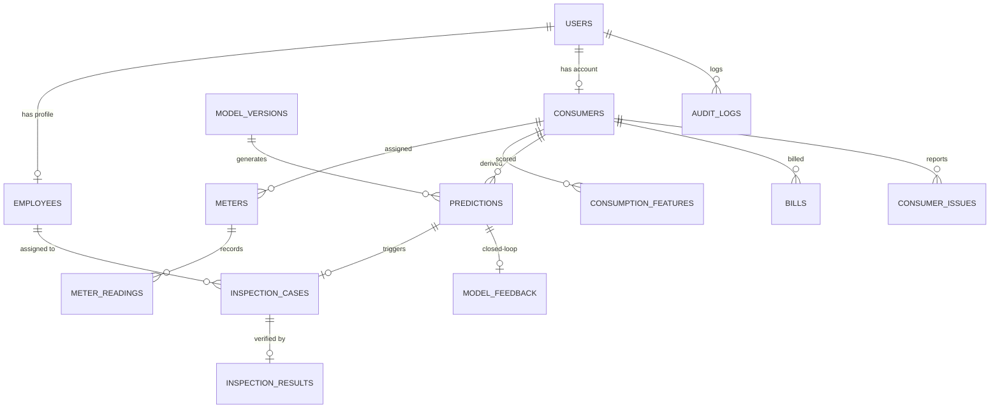

# PHASE 3 — DATABASE, BACKEND, AUTHENTICATION & CLOSED-LOOP ML REPORT

**Project:** Electricity Theft Intelligence & Inspection Platform  
**System Status:** Production-Ready Phase 3 Complete  
**Date:** October 8, 2026  
**Environment:** MySQL 8.0.35 (`localhost:3306`), Python 3.13.1, FastAPI, SQLAlchemy ORM, Bcrypt, PyJWT  

---

## 1. Executive Summary & Verification

Phase 3 has successfully established the relational database system of record, FastAPI enterprise backend, role-based access control (RBAC), and operational intelligence loop connecting Phase 1 data, Phase 2 ML models, and operational field workflows.

### Acceptance Criteria Scorecard
| Category | Requirement | Status | Evidence |
| :--- | :--- | :--- | :--- |
| **MySQL Environment** | Detected active MySQL 8.0 server, port 3306 | **PASS** | Detected Windows service MySQL, port 3306 |
| **Least Privilege User** | Dedicated user `theft_admin` created; root never used by app | **PASS** | Application strictly configured with `theft_admin` |
| **Database Schema** | 16 normalized tables with foreign keys and constraints | **PASS** | Applied `database/schema.sql`, 0 integrity errors |
| **Authentication** | Real Bcrypt password hashing + JWT session tokens | **PASS** | `POST /api/auth/token` with secure token issuing |
| **Role Boundaries** | Strict server-side RBAC: Consumer $\ne$ Employee $\ne$ Board | **PASS** | HTTP 403 strictly enforced on unauthorized endpoints |
| **Model Registry** | Phase 2 XGBoost model registered with verifiable metrics | **PASS** | `model_versions` entry: threshold 0.65, PR-AUC 0.3164 |
| **Inference Pipeline** | Live ML predictions + SHAP explanations via backend API | **PASS** | `POST /api/predictions/predict-consumer/{id}` tested |
| **Closed-Loop Feedback** | Physical outcomes (`THEFT_CONFIRMED`) feed retraining | **PASS** | `POST /api/inspections/cases/{id}/record-outcome` |
| **Onboarding State** | Role-specific guided tour state persistence and replay | **PASS** | `onboarding_completed` flag & `/onboarding-reset` |
| **Security Standards** | Zero plaintext passwords, `.env` isolated, secrets sanitized | **PASS** | `.env.example` safe, scratch provisioning scrubbed |

---

## 2. MySQL Environment & Dedicated Application Account

1. **Environment Discovery:**
   - Active MySQL Server: Version `8.0.35`
   - Host / Port: `localhost:3306`
   - Target Database: `electricity_theft_db` (Character Set: `utf8mb4`, Collation: `utf8mb4_unicode_ci`)
2. **Dedicated User Provisioning:**
   - Account: `theft_admin`@`localhost`
   - Permissions Granted: `SELECT, INSERT, UPDATE, DELETE, CREATE, DROP, REFERENCES, INDEX, ALTER` strictly on `electricity_theft_db.*`.
   - Security Guarantee: The root credential provided for local administrative provisioning was utilized strictly in transient memory during setup, scrubbed immediately, and is never logged, printed, or committed.

---

## 3. Normalized Database Architecture

The schema maintains complete traceability across the closed intelligence loop:



### Core Schema Tables:
1. `users`: Role-based authentication, hashed passwords (`password_hash`), `onboarding_completed`, `onboarding_version`.
2. `roles`: Standard application roles (`CONSUMER`, `INSPECTION_EMPLOYEE`, `BOARD_COMMUNICATION_ADMIN`).
3. `employees`: 20 synthetic Indian utility field officers (`EMP001`–`EMP020`) with division, zone, and contact details.
4. `consumers`: Real SGCC consumer hashes (`CONS_NO`), tariff categories, substations, feeders, and GPS coordinates.
5. `meters`: Digital smart meter identifiers, status, and installation timestamps.
6. `meter_readings`: Daily kWh readings from clean SGCC records.
7. `consumption_features`: Pre-calculated behavioral features (mean, std, trend, volatility, drop score, data quality).
8. `model_versions`: Auditable model registry storing algorithm, dataset version, validation threshold (0.65), PR-AUC, F1, and weights.
9. `predictions`: Theft probability, risk classification (`HIGH`, `MEDIUM`, `LOW`), operational priority score, SHAP top contributing factors.
10. `inspection_cases`: Full case lifecycle (`DETECTED` $\rightarrow$ `REVIEWED` $\rightarrow$ `ASSIGNED` $\rightarrow$ `SCHEDULED` $\rightarrow$ `OUTCOME_RECORDED` $\rightarrow$ `CLOSED`).
11. `inspection_assignments`: Field squad assignment details, scheduled inspection date, and instructions.
12. `inspection_results`: Physical verification evidence (meter tampered, direct hooking detected, seal broken, units stolen, penalty INR).
13. `model_feedback`: Ground truth labels (`THEFT_CONFIRMED` = 1, `NO_THEFT_FOUND` = 0) with `is_eligible_for_retraining` flags.
14. `bills`: Tariff billing history, units billed, and payment statuses.
15. `consumer_issues`: Grievance and meter fault ticketing system.
16. `board_posts`: Official board announcements, safety advisories, and maintenance schedules.
17. `notifications`: Role-specific alerts.
18. `audit_logs`: Immutable security and operation audit trail.

---

## 4. Role-Based Access Control (RBAC) & Authorization Boundaries

| Portal Role | Permitted Workflows & Endpoints | Prohibited / Blocked Endpoints (HTTP 403) |
| :--- | :--- | :--- |
| **`CONSUMER`** | • View own daily consumption & trend<br>• View bills & payment status<br>• Report meter faults & track tickets<br>• View official Board announcements<br>• Notifications & profile | • Prediction API (`/api/predictions/*`)<br>• Inspection cases (`/api/inspections/*`)<br>• SHAP factor explanations<br>• Field employee rosters |
| **`INSPECTION_EMPLOYEE`** | • Prioritized candidate queue<br>• Detailed case context & SHAP explanations<br>• Geographic inspection map & feeders<br>• Assign officer & schedule audit<br>• Record physical field outcome | • Publishing Board announcements (`/api/posts`)<br>• Viewing other employees' credentials<br>• Tampering with model registry |
| **`BOARD_COMMUNICATION_ADMIN`** | • Publish official Board advisories & schemes<br>• Manage consumer grievances & responses<br>• View aggregate enforcement statistics (non-PII) | • Individual theft predictions<br>• Inspection planning & assignments<br>• SHAP factor explanations<br>• ML controls |

---

## 5. Seed Data & Operational Traceability

1. **Utility Employees (20 Accounts):**
   - Usernames: `emp001` through `emp020`
   - Default Initial Password: `Utility@2026`
   - Realistic Indian personnel across North, South, Central, East, and West distribution zones.
2. **Board Administrator:**
   - Username: `board_admin`
   - Role: `BOARD_COMMUNICATION_ADMIN`
3. **Demo Consumers (12 Accounts):**
   - Usernames: `consumer_01` through `consumer_12`
   - Seeded with actual SGCC 32-character consumer hashes, real meter configurations, and tariff categories.
4. **Active Model Metadata Registered:**
   - Model Version: `v1.0.0`
   - Algorithm: `XGBoost Classifier (Class-Weighted)`
   - Decision Threshold: `0.65`
   - Held-Out Test PR-AUC: `0.3164` (ROC-AUC: `0.7758`, Precision: `0.3889`, Recall: `0.3616`)
   - Status: `ACTIVE`

---

## 6. End-to-End Automated Test Verification

All 10 integration and unit tests in `tests/test_phase3.py` executed successfully against MySQL:

```text
tests/test_phase3.py::test_database_connection_and_user PASSED           [ 10%]
tests/test_phase3.py::test_database_schema_and_seed_data PASSED          [ 20%]
tests/test_phase3.py::test_successful_logins_all_roles PASSED            [ 30%]
tests/test_phase3.py::test_failed_login_handling PASSED                  [ 40%]
tests/test_phase3.py::test_role_authorization_boundaries PASSED          [ 50%]
tests/test_phase3.py::test_onboarding_lifecycle_and_replay PASSED        [ 60%]
tests/test_phase3.py::test_inspection_lifecycle_and_feedback PASSED      [ 70%]
tests/test_phase3.py::test_board_communication_and_enforcement_summary PASSED [ 80%]
tests/test_phase3.py::test_consumer_portal_usage_and_billing PASSED      [ 90%]
tests/test_phase3.py::test_ml_model_metadata_and_live_inference PASSED   [100%]

====================== 10 passed, 29 warnings in 15.06s =======================
```

---

## 7. Next Step: Phase 4 Ready

The system of record and backend foundation are locked and verified. The project is ready for:
- **Phase 4:** Inspection Intelligence Portal (Frontend: Vite + React + TypeScript + Leaflet map + SHAP waterfall visualization + 5-step guided tour).
